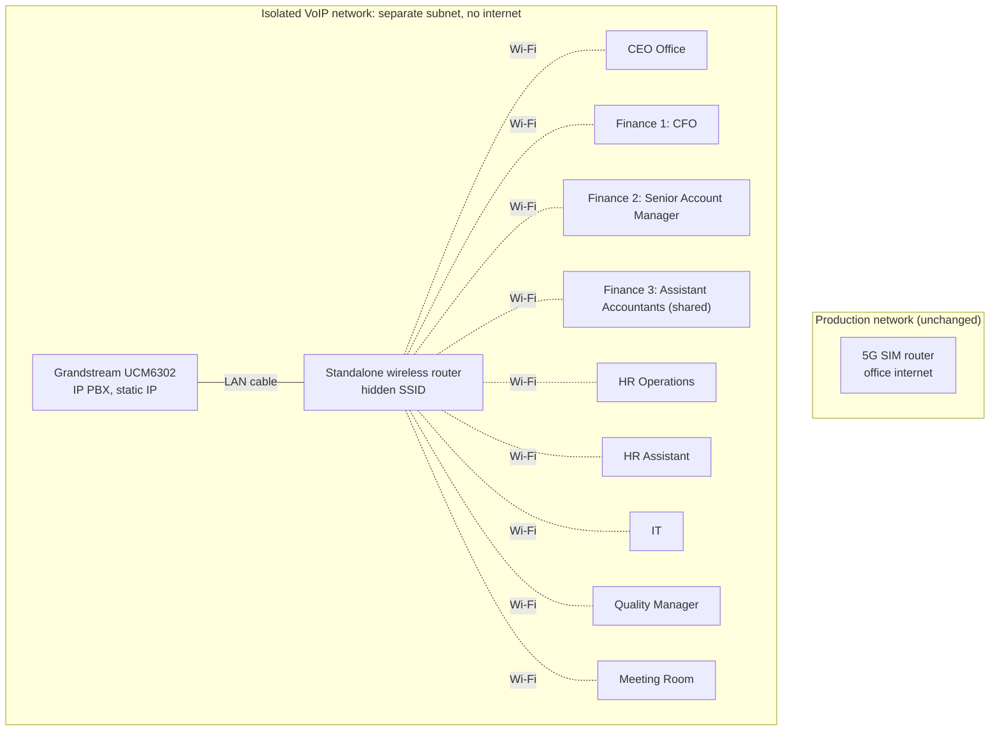

# Internal VoIP Calling System (Grandstream UCM6302)

Low-cost, isolated internal phone system for a 9-extension office, built on a wireless network with no new cabling and no internet dependency.

| | |
| --- | --- |
| **Role** | Sole IT engineer: design, configuration, deployment, documentation |
| **Environment** | Second-floor office of a three-storey building, multi-branch restaurant company in Riyadh |
| **Equipment** | 1 × Grandstream UCM6302 IP PBX, 9 × Grandstream GRP2612W Wi-Fi IP phones, 1 × repurposed wireless router |
| **Status** | In daily use; expanded in Phases Two and Three (see [Later updates](#later-updates)) |

## The problem

Staff had no way to reach each other between rooms except walking over, or using personal mobiles and messaging apps. The company wanted simple internal calling at the lowest practical cost, without disturbing the existing office network.

## Constraints

- **Minimal budget**: no new cabling runs, reuse existing equipment where possible.
- **Existing network must not be touched**: the office runs on a 5G SIM router that is in production use.
- **Internal calls only**: no external trunks or internet needed in this phase.
- **One-person IT team**: the system had to be easy to administer and troubleshoot.

## The solution

- Chose the **GRP2612W** specifically for its built-in Wi-Fi, which removed the need for network cabling to each desk.
- Repurposed a **spare wireless router** as a dedicated voice network, on a **different IP subnet** from the production 5G network and with **no internet uplink**.
- Connected the **UCM6302** to that router by LAN cable with a static IP.
- Gave every phone a **static IP** so each device is predictable to find and troubleshoot.
- Disabled SSID broadcast on the voice network to keep it out of casual view.

## Network diagram

There is deliberately no link between the two networks.

## Extension allocation

| Room | User | Phones |
| --- | --- | --- |
| CEO Office | CEO | 1 |
| Finance Room 1 | CFO | 1 |
| Finance Room 2 | Senior Account Manager | 1 |
| Finance Room 3 | Two Assistant Accountants | 1 (shared) |
| HR | HR Operations | 1 |
| HR | HR Assistant | 1 |
| IT Department | IT | 1 |
| Quality Department | Quality Manager | 1 |
| Meeting Room | Shared | 1 |
| **Total** | | **9** |

## PBX configuration

1. Created and named one extension per phone location.
2. Provisioned the phones with **Grandstream Zero Config** and bound each extension to its handset.
3. Assigned static addressing to the PBX and all endpoints.
4. Created a Paging/Intercom group, `Meeting_room_announcement`, for meeting-room announcements.

## Challenges and troubleshooting

| Challenge | What happened | What I did |
| --- | --- | --- |
| **Choosing the platform** | Limited budget, several brands to compare | Compared brands on features, price and management interface; chose Grandstream |
| **No cabling to desks** | Existing office had no suitable LAN points at the phone locations; new structured cabling would raise cost and complexity | Selected the GRP2612W specifically for its Wi-Fi capability |
| **SIP registration failures** | Phones were first set up on DHCP; when an address changed, phones lost connectivity or failed to register | Moved every phone to a static IP. The issue did not return |
| **Intermittent disconnections** | A phone would occasionally drop off the UCM6302 | First step: restart the phone and rejoin Wi-Fi. If that failed: check the phone's IP details and its extension settings on the UCM |
| **Unexpected call forwarding** | Some phones occasionally entered a call-forwarding state | Restarted and reconnected the phone, then checked the UCM configuration. Root cause not yet confirmed |
| **Wireless interference** | Risk of conflict between the voice router and the existing office Wi-Fi | Adjusted the voice router's wireless settings to keep it clear of the production network |

### Lessons learned

- Plan IP addressing before deployment; do not leave voice endpoints on DHCP without reservations.
- Check Wi-Fi coverage and cabling before choosing hardware, because it decides the phone model.
- Consider wireless interference whenever voice runs over Wi-Fi.
- Keep configuration documented from day one, so troubleshooting is quick.

## Result

- Nine locations can call each other directly.
- No new cabling, one reused router, no recurring cost.
- Voice traffic is fully separated from the production network.
- Every device has a documented, fixed address.

## Limitations and next steps

Being honest about what Phase One does not do:

- **Hidden SSID is not a security control.** It only reduces casual visibility; the real protection is the Wi-Fi encryption and passphrase. Next step: confirm WPA2/WPA3 with a strong key and restrict the router admin interface.
- **Single points of failure.** One router and one PBX. Next step: scheduled UCM configuration backups and a documented recovery procedure.
- **Voice over Wi-Fi depends on signal quality.** Next step: survey signal strength per room, and consider wired PoE phones or QoS for any weak spots.
- **Internal only.** A later phase could add a SIP trunk for external calls, on a properly segmented VLAN with firewall rules.

## Later updates

### Phase Two

- Added a phone for the CEO through a new ceiling access point, avoiding a cable run to the desk.
- Registered the door station and indoor video station as extensions, with a ring group so a visitor call rings several phones at once. See [Door access control](../02-access-control-door-entry/README.md).
- Moved the PBX and voice router into a network cabinet, connected through a managed switch on VLAN 20.

### Phase Three

- Added three more extensions at the company's request: the central kitchen manager's desk (first floor), the delivery-door cashier and the restaurant kitchen (both ground floor).
- The voice network became VLAN 20 on the new OPNsense firewall. It still has **no internet by design**; the firewall provides only DNS and time (NTP) to it. See [OPNsense firewall](../05-opnsense-firewall/README.md).
- The handsets now connect through the managed Ruijie Wi-Fi network on an untagged SSID. Tagging that SSID caused an outage, documented in [Switching and VLANs](../04-switching-and-vlans/README.md#troubleshooting).
- **PBX clean-up from the firewall log.** The firewall log showed the PBX repeatedly trying to reach the internet. Two settings were the cause: a STUN lookup for its external address and a public "external host" entry. Neither can work on a network with no internet, so I disabled both and pointed the PBX's time source at the firewall.
- Learned that UCM changes need both **Save** and **Apply Changes**, and that applying can restart the calling service, so changes are scheduled outside working hours.

## Skills demonstrated

`VoIP / SIP` · `Grandstream UCM` · `IP addressing and subnetting` · `Network segmentation` · `Wireless networking` · `Device provisioning` · `Technical documentation`
