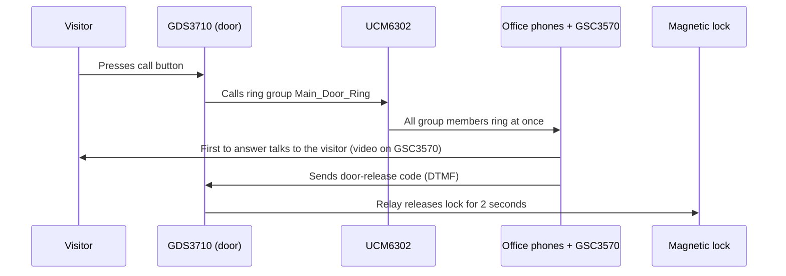

# Door Access Control and Video Entry System

Video door-entry system with remote release, RFID cards and PIN entry, integrated with the office phone system.

| | |
| --- | --- |
| **Role** | Sole IT engineer: proposal, design, wiring, configuration, troubleshooting |
| **Environment** | Office on the upper floor of a three-storey restaurant building, with the controlled entrance on the ground floor |
| **Related** | [VoIP system](../01-grandstream-voip/README.md) · [Switching and VLANs](../04-switching-and-vlans/README.md) |
| **Status** | In daily use |

## The problem

Anyone could enter and leave the office. There was no way to limit entry to authorised staff, and handling a visitor meant someone walking down to the ground-floor door. I identified the gap and proposed this project.

## Equipment

| Equipment | Purpose |
| --- | --- |
| Grandstream GDS3710 | Door station at the entrance: keypad, RFID reader, camera, lock relay |
| Grandstream GSC3570 | Indoor video intercom and door-control station |
| Magnetic door lock | Holds the door closed |
| Exit button | Releases the door from inside |
| 12 V power supply | Powers the magnetic lock |
| Grandstream UCM6302 | Existing IP PBX from the VoIP project |

The GDS3710 is powered and connected over PoE from the office switch, on the voice VLAN.

## How the door entry works

Three ways to open the door:

1. **Remote release** by whoever answers the door call.
2. **RFID card.** Each authorised employee has an individually enrolled card.
3. **PIN** on the GDS3710 keypad.

People leaving use the exit button inside the door.

## What I configured

1. SIP extensions on the UCM for the GDS3710 and the GSC3570.
2. Video calling on the GSC3570, so staff can see the visitor.
3. Ring group `Main_Door_Ring`, so all selected phones ring at once.
4. Remote door release by keypad code during the call, with a 2-second lock release.
5. Individual RFID card enrolment for each employee.
6. Lock, exit button and 12 V supply wired to the GDS3710 relay.

## Challenges and troubleshooting

| Challenge | What happened | What I did |
| --- | --- | --- |
| **Lock wiring and power** | The hardest part of the project. The GDS relay, magnetic lock, exit button and 12 V supply all had to work as one circuit, and the lock needed a continuously available power source | Several rounds of testing and rewiring; used a constant supply with a 12 V adapter and good-quality copper cable for the low-voltage run |
| **Cable route redone** | The first cable run to the door was surface-mounted. Management then asked for it to be hidden in the wall | Re-ran the cable inside the wall |
| **PIN "not working"** | PIN entry failed during first tests | The device was fine; the entry sequence was incomplete. The GDS3710 expects `*`, then the PIN, then `#` |

Installation notes: the supplied weather-sealing parts were fitted on the door station, PoE removed the need for a separate power feed to it, and Grandstream's GS Search tool was useful for finding devices on the network.

## Safety consideration

The office sits above a restaurant, so emergency exit mattered when choosing the lock. A magnetic lock releases when it loses power, so a power failure cannot trap people inside. I tested this by cutting power and confirming the door released. The exit button allows release from inside at any time.

Not yet documented: fire-alarm interface and a formal check against local fire and life-safety requirements.

## Limitations and next steps

- **Card and code lifecycle.** Add a written process to revoke RFID cards when staff leave and to change the door-release code and PINs on a schedule.
- **Power resilience.** A UPS for the switch that powers the door station, so door entry and intercom survive short outages.
- **Entry logs.** Review access logs on a regular schedule.

## Lessons learned

- Physical security is its own design area: door hardware, power behaviour, exit controls and weather sealing matter as much as the IP device.
- Get the cable path approved before permanent installation.
- When a device "does not work", check the expected input sequence before suspecting a fault.

## Skills demonstrated

`Access control` · `SIP / Grandstream UCM` · `Video intercom` · `RFID` · `PoE` · `Low-voltage wiring` · `Troubleshooting`
