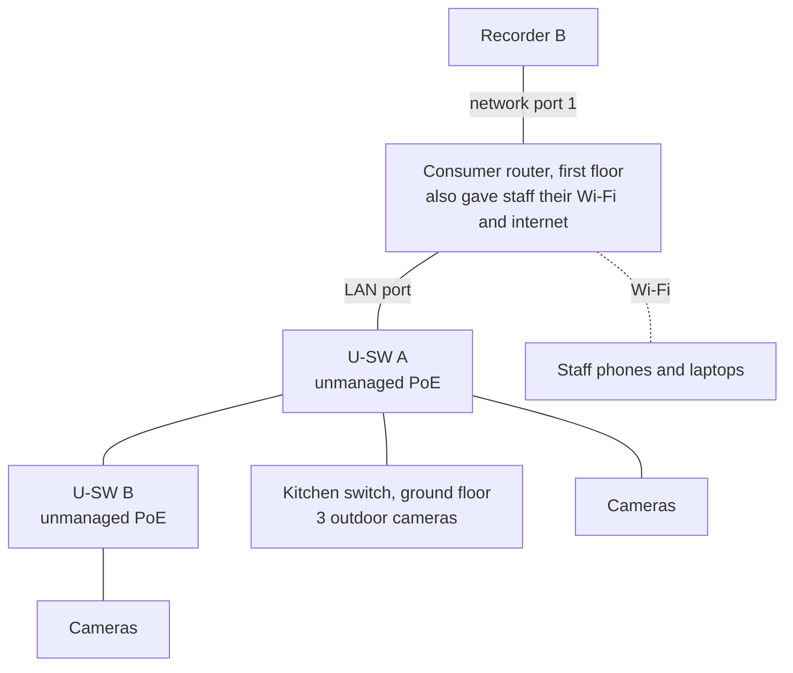
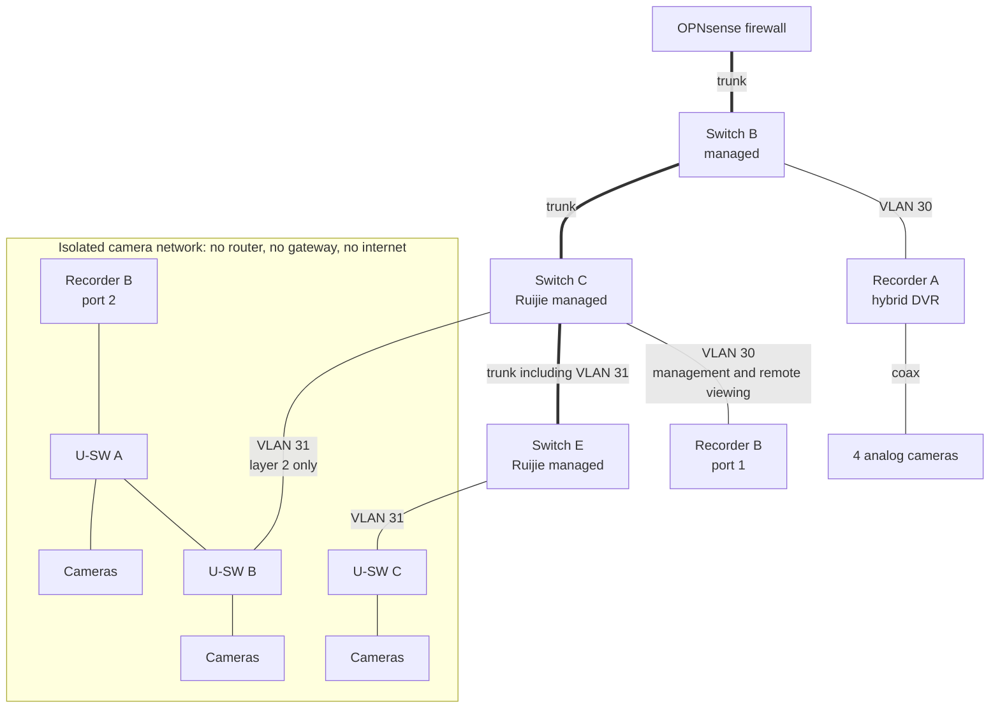

# CCTV Surveillance System

Two recorders and 40+ cameras across a three-storey building, separated from the staff network, with remote viewing that works through carrier-grade NAT.

| | |
| --- | --- |
| **Role** | Sole IT engineer: installation, redesign, network isolation, troubleshooting |
| **Environment** | Three-storey building: restaurant kitchens and bakery production on the lower floors, offices above |
| **Related** | [Switching and VLANs](../04-switching-and-vlans/README.md) · [OPNsense firewall](../05-opnsense-firewall/README.md) |
| **Status** | In daily use |

## How it evolved

| Phase | What happened |
| --- | --- |
| **Two** | I installed Recorder A with four cameras covering the office hallway and elevator. It ran on its own router because the office router was full. |
| **Three** | I took over the building's existing camera estate (Recorder B, 40+ cameras), found it was the cause of staff network drops, and redesigned how it connects. Both recorders moved onto the CCTV VLAN behind the new firewall. |

## Equipment

| Equipment | Purpose |
| --- | --- |
| Recorder A: Hikvision iDS-7208HUHI-M1/X (hybrid DVR) | Four analog cameras on coax, with a separate camera power supply: three in the office hallway, one at the elevator |
| Recorder B: Hikvision DS-9664NI-M8 (NVR, two network ports) | 40+ IP cameras throughout the building |
| 2 × Hikvision 24-port unmanaged PoE switches (U-SW A, U-SW B) | Power and connect the main camera estate |
| Unmanaged switch (U-SW C) | Further cameras on the ground floor |
| Ruijie managed switches | Carry the camera network between floors on VLAN 31 |

## The problem I found

When I traced the existing camera system in Phase Three, this is how it was wired:

Every one of the 40+ cameras was taking its IP address from the same consumer router that served staff internet on that floor, and all of the camera traffic passed through it. Staff complained that their connection kept dropping. The router was overloaded by a job it was never meant to do.

## The fix: put the cameras on their own network

Recorder B has two network ports, so I used them for two separate jobs:

- **Port 2** sits on a camera-only network. This is where the cameras live and how the recorder records them. No router is involved, so recording no longer depends on any router or on the firewall.
- **Port 1** sits on VLAN 30 (CCTV). It is used only for managing the recorder and for remote viewing through Hik-Connect.
- **VLAN 31** is a "transport" VLAN. It carries the camera network between floors over the managed switches so that cameras on U-SW C join the same network as the others. It has no IP addresses, no gateway and no interface on the firewall, deliberately: nothing on it needs to be routed.
- The recorder does not route between its two ports, so the cameras have no path to the staff network or the internet.

The staff network drops stopped once the cameras were taken off the router.

## CCTV VLAN policy

VLAN 30 gets **internet only**, which Hik-Connect needs for remote viewing:

1. DNS and time only from the firewall.
2. Outbound internet allowed.
3. Everything internal blocked: the recorders cannot reach office, voice, staff or management networks.

## Challenges and troubleshooting

| Challenge | What happened | What I did |
| --- | --- | --- |
| **Staff network drops** | 40+ cameras were DHCP clients of a staff internet router | Moved the cameras to an isolated network on the recorder's second port (above) |
| **Remote viewing broken in a strange pattern** | From mobile data, the branch recorders worked and the head-office ones did not. From inside head office, the reverse | Root cause was the firewall randomising source ports on outbound NAT. Full case study in [OPNsense firewall](../05-opnsense-firewall/README.md#case-study-remote-camera-viewing) |
| **Streams stopped after about 20 seconds** | The firewall's default timeouts closed idle UDP sessions faster than Hik-Connect's keepalives | Set firewall optimisation to Conservative |
| **Recorders could not resolve anything** | Their DNS was set to a public resolver, but VLAN 30 only allows DNS to the firewall | Pointed the recorders' DNS at the firewall |
| **Block rule broke Hik-Connect** | A "block internal networks" rule placed above the pass rules caught the return traffic | Moved the block below the passes |
| **Poor remote video quality** | Low Bitrate Mode was switched on in the Hik-Connect platform settings | Turned it off |
| **Remote viewing slow at certain times** | Upload on the 5G connection varies from about 1.6 to 11.6 Mbps through the day | Check uplink speed first before changing any configuration |
| **Router at client limit (Phase Two)** | The office router could not take another client, so Recorder A could not join it | Gave Recorder A its own router, later replaced by VLAN 30 |

## Lessons learned

- A device that serves users should not also be the DHCP server and gateway for a large fleet of cameras.
- Use what the hardware already offers: the recorder's second network port solved the problem without new equipment.
- Not every VLAN needs a gateway. A layer-2-only VLAN is the right tool for stretching an isolated network between floors.
- Fix the device as well as the network: the recorders needed both firewall changes and their own DNS and bitrate settings corrected.

## Next steps

- **Access to footage.** Document who may view and export recordings, with individual accounts instead of shared logins.
- **Retention.** Record how many days each recorder holds and confirm it meets the company's needs.
- **Power resilience.** UPS cover for the recorders and camera switches.
- **Monitoring.** Alert when a recorder or camera goes offline.

## Skills demonstrated

`CCTV` · `Hikvision NVR / DVR` · `Dual-homed devices` · `Network isolation` · `Layer-2 transport VLAN` · `Hik-Connect` · `NAT troubleshooting` · `Root-cause analysis`
