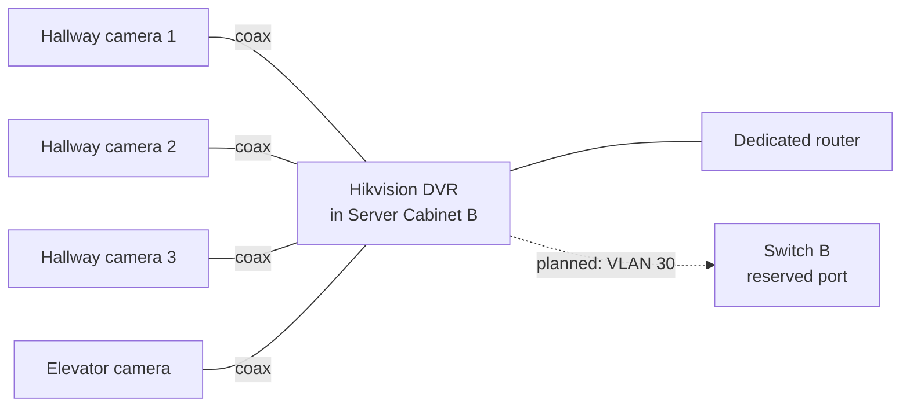

# CCTV Surveillance System

Recorded camera coverage of the office circulation areas, on its own network.

| | |
| --- | --- |
| **Role** | Sole IT engineer: proposal, design, installation, configuration |
| **Environment** | Second-floor office of a three-storey building |
| **Related** | [Switching and VLANs](../04-switching-and-vlans/README.md) |
| **Status** | In daily use; VLAN migration planned |

## The problem

The office had no surveillance. No cameras or recording covered the route into the office or its shared areas. I identified the gap and proposed this project.

## Equipment

| Equipment | Purpose |
| --- | --- |
| Hikvision iDS-7208HUHI-M1/X | DVR: records and manages the cameras |
| 4 analog cameras | Connected to the DVR by coax, with a separate camera power supply |
| Dedicated router | Network connection for the DVR |

## Design

- **Coverage:** three cameras on the office hallway and one facing the elevator. The aim was to cover entry and circulation areas, not to put a camera in every office.
- **Placement:** the DVR sits in a network cabinet by the stairs, not in an open office.
- **Network:** only the DVR is on the network. The cameras are analog, so they cannot be reached over IP.

## Challenges and troubleshooting

| Challenge | What happened | What I did |
| --- | --- | --- |
| **Router at client limit** | The office internet router had reached its practical client limit, so the DVR could not join it | Deployed a separate router for the DVR |
| **No home for the equipment** | There was no cabinet or secure place for a recorder | Installed a network cabinet by the stair area and mounted the DVR inside |

## Limitations and next steps

- **Move the DVR into VLAN 30.** The VLAN exists and a switch port is reserved for it; the DVR still uses its own router. Once moved, add rules limiting which devices can reach it.
- **Access to footage.** Document who may view and export recordings, and use individual accounts instead of a shared login.
- **Retention.** Record how many days of footage the disk holds and confirm it meets the company's needs.
- **Power resilience.** A UPS for the cabinet, so recording continues through short outages.

## Skills demonstrated

`CCTV` · `Hikvision DVR` · `Camera placement` · `Coax cabling` · `Network isolation`
