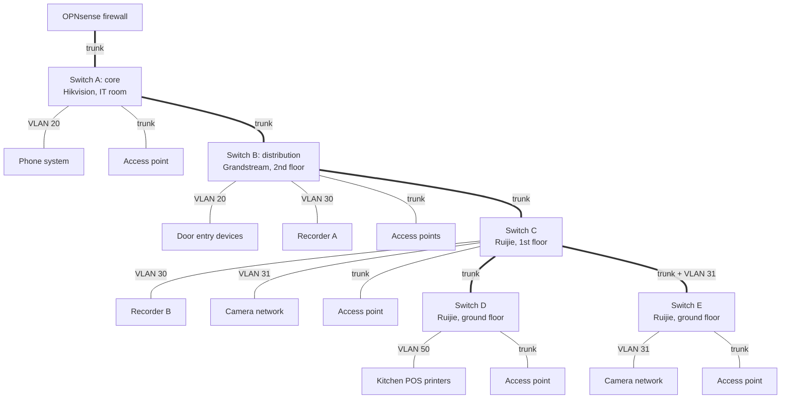

# Switching, VLANs and Wireless

A segmented network for a three-storey building: eight VLANs carried over five managed switches from three vendors, and a managed Wi-Fi system where each SSID maps to its own VLAN.

| | |
| --- | --- |
| **Role** | Sole IT engineer: design, cabling, configuration, documentation |
| **Environment** | Three-storey building: offices, restaurant kitchens, bakery production and a coffee counter |
| **Related** | [OPNsense firewall](../05-opnsense-firewall/README.md) · [CCTV](../03-cctv-surveillance/README.md) · [VoIP](../01-grandstream-voip/README.md) |
| **Status** | In service |

## How it evolved

| Phase | Network |
| --- | --- |
| **One** | No switching. One Wi-Fi router per service. |
| **Two** | Two managed switches in two cabinets, an 802.1Q trunk between them, and the first VLANs: 20 (voice and door entry) and 30 (CCTV, reserved). |
| **Three** | Eight separate routers replaced by one firewall. Five managed switches, four cabinets, eight VLANs and managed Wi-Fi across all floors. |

## Equipment

| Device | Model | Role |
| --- | --- | --- |
| Switch A | Hikvision DS-3E1518P-EI/M, 18-port PoE | Core switch, IT room cabinet. Trunk to the firewall and to Switch B |
| Switch B | Grandstream GWN7803P, 24-port PoE + 4 SFP | Distribution, second-floor stair cabinet |
| Switch C | Ruijie RG-ES206GS-P | First-floor cabinet: Recorder B, the camera network, Switches D and E |
| Switch D | Ruijie RG-ES206GS-P | Ground floor: access point and kitchen POS printers |
| Switch E | Ruijie RG-ES206GS-P | Ground floor: further cameras and an access point |
| Access points | Ruijie RAP2260(G) and RAP2200(F) | One Reyee group, managed through Ruijie Cloud |

## Topology

Everything below the firewall rides one chain of trunks. A missing VLAN tag on any single trunk port breaks that VLAN for everything downstream, which is why the inter-switch links are documented and left alone.

## VLAN design

| VLAN | Zone | Internet | Notes |
| --- | --- | --- | --- |
| 99 | Management | Admin devices only | Switch management. Native (untagged) VLAN on every trunk |
| 10 | Office | Yes | Office laptops and staff devices |
| 20 | Voice | **No, by design** | Phone system, handsets, door entry |
| 30 | CCTV | Internet only | Recorders, for remote viewing |
| 31 | Camera transport | None | Layer 2 only: no addresses, no gateway |
| 40 | Employee | Yes, through a captive portal | Staff personal phones |
| 50 | Business | Yes | POS devices and business equipment |
| 150 | Executive | Yes | CEO room only |

The firewall is the gateway, DHCP, DNS and time server for every routed VLAN, and blocks traffic between them. See [OPNsense firewall](../05-opnsense-firewall/README.md).

### Adding a VLAN: the six-place checklist

Missing any one of these gives a device that connects but gets no IP address, with no error anywhere. It happened three times before I wrote the checklist.

1. VLAN interface on the firewall
2. DHCP range for it
3. Firewall rules for it
4. Tagged list on the firewall trunk port and the uplink on Switch A
5. Tagged list on the inter-switch trunk on Switch B and onwards
6. Tagged list on every access-point port that will broadcast an SSID for it

## Three vendors, three vocabularies

The same idea is configured differently on each brand, so I documented the translation:

| Vendor | Port for one VLAN | Port carrying several VLANs |
| --- | --- | --- |
| Hikvision | ACCESS | TRUNK: sends its PVID untagged and the rest of the allowed list tagged |
| Grandstream | Access | Hybrid: one untagged VLAN plus a chosen set of tagged ones (used for the access-point ports) |
| Ruijie | Access | Trunk: native VLAN plus a permitted list |

**Management VLAN decision.** On the Ruijie switches I put the uplink's native VLAN on 99 (management) rather than 20. Keeping 20 would have made the hardware swap seamless, but 99 is the correct end state: every switch's management address then sits in one protected network instead of sharing a broadcast domain with the phones.

## Wireless

Five SSIDs across a self-organising Reyee group managed in Ruijie Cloud. Each SSID maps to a VLAN, which only works where the switch port underneath carries that VLAN tag.

| SSID purpose | VLAN | Broadcast on |
| --- | --- | --- |
| Voice handsets | 20, **untagged** | All access points |
| Office | 10, tagged | All access points |
| Employee | 40, tagged | All access points |
| Business / POS | 50, tagged | All access points |
| Executive | 150, tagged | CEO room access point only, through a cloud AP group |

- **Wireless bridges for the POS printers.** Three POS printers at the coffee counter had been connected with long cables across the floor, and staff tripped over them. I placed a TP-Link TL-WA850RE extender beside each printer, joined it to the Business SSID with its own SSID broadcast turned off, and connected the printer to the extender's LAN port with a short Cat6 cable. The printers stay wired and land on VLAN 50 with no cable across the floor.
- **Why every POS device is on the Business VLAN.** All POS terminals, delivery-app tablets and kitchen printers sit on VLAN 50. Finding a faulty device, writing firewall rules and changing policy all happen in one place, separate from staff phones.
- **Speed upgrade.** The RAP2200(F) has a 100 Mbps uplink, which caps it at about 70 Mbps. I replaced the CEO-area unit with a RAP2260(G), which measures around 400 Mbps.
- **Cloud overrides local.** The local web console on the master AP can't limit an SSID to specific access points, but Ruijie Cloud can through AP groups. Once the network is adopted into the cloud, changes made locally silently revert, so all changes go through the cloud.

## Troubleshooting

| Symptom | Cause | Fix |
| --- | --- | --- |
| Every handset connects to Wi-Fi but reports an IP configuration failure | The voice SSID was set to tagged VLAN 20 on AP ports whose untagged VLAN was already 20. The switch drops those frames silently | Set the SSID's VLAN back to default so the port's untagged VLAN does the work. Deleted a duplicate SSID with the same fault |
| Devices see the Business SSID but never get an address | VLAN 50 had never been added to the tagged list on the access-point ports. The same thing recurred with VLANs 40 and 150 | Added the tags; wrote the six-place checklist |
| Access points showing "DNS failed" and offline in the cloud | APs manage themselves on the voice VLAN, which has no internet, so their self-test failed. Wi-Fi itself still worked | Rejected the obvious fix (changing the AP ports' untagged VLAN), because that would have moved every handset off the phone system. Instead added two narrow firewall rules allowing only the APs' own addresses out |
| Same fault came back later | The APs' DHCP addresses changed, so the firewall alias no longer matched them | Permanent fix: reserve the AP addresses |
| After a power cut, two APs offline and nearby devices can't connect even with a static IP | Switch B's port view: one AP port up with PoE, one down but drawing PoE, one with no PoE | Powered off the faulty AP so nearby devices fell back to a working one. Ruijie Cloud then showed a new master elected and an "offline" AP that was only a stale record |
| Switch loses its configuration after a reboot | Changes not saved to the startup configuration | Save to startup after every change, then export a backup |

## Lessons learned

- A tagged frame arriving on a port that doesn't expect that tag is dropped with no error. The symptom is always "connects but gets no IP".
- A new VLAN must be added at every hop.
- Reserve the addresses of anything a rule or alias refers to by address.
- A configuration that only works until the next power cut is not finished. Save, back up and test after a restart.

## Next steps

- Move access-point management from the voice VLAN to the management VLAN.
- Move the remaining wired office ports from the default VLAN to VLAN 10.
- Finish recording Switch E's port table.
- Monitor every switch and access point with Uptime Kuma.

## Skills demonstrated

`802.1Q VLANs` · `Trunk, access and hybrid ports` · `Multi-vendor switching` · `PoE` · `Managed Wi-Fi` · `SSID-to-VLAN mapping` · `Layer-2 troubleshooting` · `Network documentation`
