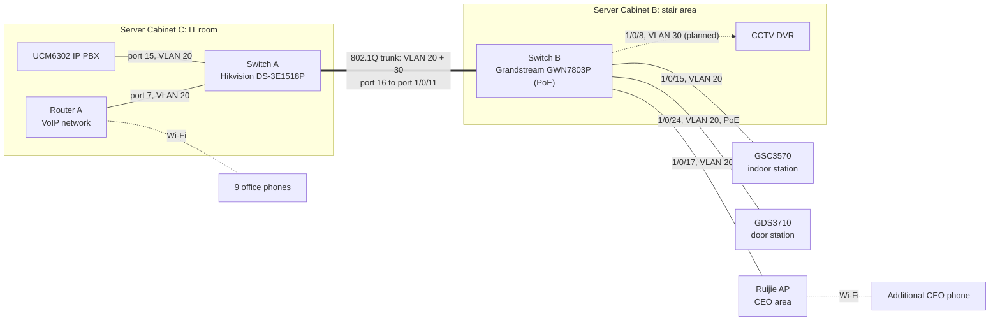

# Switching, Network Cabinets and VLAN Segmentation

Turned a flat, single-router office network into a structured one: two cabinets, two managed switches, an 802.1Q trunk and separate VLANs for different services.

| | |
| --- | --- |
| **Role** | Sole IT engineer: design, cabling, configuration, documentation |
| **Environment** | Second-floor office of a three-storey building |
| **Related** | [VoIP system](../01-grandstream-voip/README.md) · [Access control](../02-access-control-door-entry/README.md) · [CCTV](../03-cctv-surveillance/README.md) |
| **Status** | In daily use; VLAN 30 migration planned |

## The problem

The original network was one Wi-Fi router per service, with no switching, no PoE and no segmentation. Adding door entry, CCTV and more phones needed wired ports, power over Ethernet and a way to keep services apart.

## Equipment

| Equipment | Purpose |
| --- | --- |
| Hikvision DS-3E1518P-EI/M | Switch A (existing spare, reused) |
| Grandstream GWN7803P | Switch B (PoE) |
| Ruijie 2200F access point | Wireless coverage for the CEO area |
| 2 network cabinets | Cabinet C in the IT room, Cabinet B by the stairs |
| RJ45 structured-cabling link | Connects the two cabinets |

## Network design

### VLANs

| VLAN | Purpose | State |
| --- | --- | --- |
| 20 | Voice and door-entry devices | Live |
| 30 | Surveillance | Created and trunked; port reserved for the DVR |

### Switch port map

| Switch | Port | Connected to | VLAN |
| --- | --- | --- | --- |
| A | 7 | Router A | 20 |
| A | 15 | UCM6302 | 20 |
| A | 16 | Uplink to Switch B | Trunk: 20, 30 |
| B | 1/0/8 | Reserved for the DVR (planned) | 30 untagged |
| B | 1/0/11 | Uplink to Switch A | 20, 30 tagged |
| B | 1/0/15 | GSC3570 | 20 untagged |
| B | 1/0/17 | Ruijie AP | 20 untagged |
| B | 1/0/24 | GDS3710 | 20 untagged |

## What I configured

1. Two cabinets: Cabinet C in the IT room (UCM, Router A, Switch A) and Cabinet B by the stairs (Switch B, DVR).
2. A new RJ45 link between the cabinets, configured as an 802.1Q trunk carrying both VLANs.
3. VLAN 20 and VLAN 30 on both switches: tagged on the uplinks, untagged on device ports.
4. PoE on Switch B for the door station.
5. A ceiling-mounted access point on VLAN 20, to give the CEO an additional phone without a new cable run to the desk.

## Challenges and troubleshooting

| Challenge | What happened | What I did |
| --- | --- | --- |
| **Network not built for this** | No spare switching, PoE or segmentation for the new devices | Added a PoE switch, reused a spare managed switch and introduced VLANs |
| **Linking the cabinets** | No cable path existed between the IT room and the stair area | Installed a dedicated RJ45 link and carried both VLANs over it |
| **Two switch brands** | Hikvision and Grandstream switches describe VLAN port modes differently | Matched the tagged and untagged settings on both ends of the trunk and tested each VLAN across it |

## Limitations and next steps

- **Too many separate routers.** Office internet, voice and CCTV each have their own. A single firewall routing between VLANs with explicit rules would be easier to secure and manage.
- **Finish VLAN 30.** Move the DVR onto its reserved port.
- **Complete the port documentation:** switch, port, device, VLAN, IP and physical location for every port.
- **Power resilience.** A UPS for both cabinets.

## Lessons learned

- Separate services logically instead of putting every device on one network.
- Build for expansion. Cabinets, a trunk and VLANs made each later addition simpler.
- Plan cable paths and cabinet locations before terminating anything.
- Keep the switch-port table current as the network grows.

## Skills demonstrated

`802.1Q VLANs` · `Trunk and access ports` · `PoE switching` · `Multi-vendor switching` · `Structured cabling` · `Wireless` · `Network documentation`
