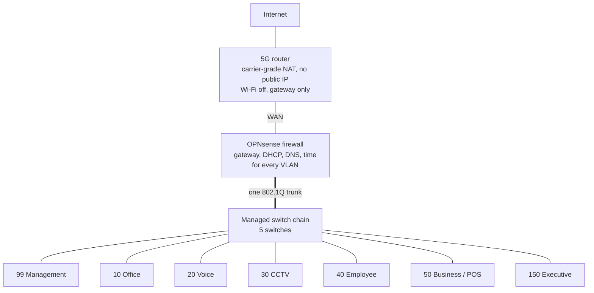

# OPNsense Firewall and Network Consolidation

Replaced eight separate consumer routers with one OPNsense firewall: seven routed VLANs, a default-deny policy for each zone, remote access through carrier-grade NAT, and a captive portal for staff Wi-Fi.

| | |
| --- | --- |
| **Role** | Sole IT engineer: design, build, firewall policy, troubleshooting |
| **Environment** | Three-storey head office: offices, restaurant kitchens, bakery production and a coffee counter |
| **Platform** | OPNsense, first as a Hyper-V virtual machine, then on a dedicated appliance ([migration write-up](../06-firewall-migration-bare-metal/README.md)) |
| **Related** | [Switching, VLANs and wireless](../04-switching-and-vlans/README.md) · [CCTV](../03-cctv-surveillance/README.md) |
| **Status** | In service |

## The problem: eight routers, no control

Before Phase Three, every part of the building had grown its own router:

| Router | What it was doing |
| --- | --- |
| A | Phone system network (no internet) |
| B | Office internet (5G) |
| C | CEO's room |
| D | Second-floor CCTV recorder |
| E | First floor: the 40+ camera recorder **and** staff internet |
| F | Ground-floor cashier, plus the kitchen POS printers |
| G | Ground-floor operations desk, added only because the other routers' signal didn't reach, and also used by bakery staff |
| H | Coffee counter POS devices; some printers on long LAN cables that staff tripped over |

There was no central control or visibility, every network had its own shared password, cameras shared a router with users, and nothing could be restricted between groups.

## The design

The firewall is the only DNS and time server for every VLAN. That is what makes tight rules possible: a VLAN that only needs DNS and time can be allowed exactly those two things and nothing else.

## Zone policy

Rules are checked top to bottom, the first match wins, and anything not explicitly allowed is denied.

| VLAN | Zone | Allowed |
| --- | --- | --- |
| 99 | Management | Admin devices: everything. Switches: DNS and time only. The factory "allow LAN to any" rule was deleted |
| 10 | Office | Internet. No internal networks, with one exception for printing (below) |
| 20 | Voice | DNS and time from the firewall only. No internet. Narrow exception for the access points' own addresses |
| 30 | CCTV | Internet only, for remote viewing. No internal networks |
| 40 | Employee | Internet through a captive portal. No internal networks |
| 50 | Business / POS | Internet. No internal networks |
| 150 | Executive | Internet. No internal networks |

**The mechanism.** An alias called `Private_Networks` holds every private (RFC 1918) range, meaning "everything internal". A rule that blocks a VLAN from reaching that alias, followed by a rule that passes it to anything, gives the VLAN internet and nothing else, because internet destinations are public and never match the block.

Example, the Office VLAN:

| # | Action | From | To | Why |
| --- | --- | --- | --- | --- |
| 1 | Pass | Admin devices | Any | IT access |
| 2 | Pass | Office network | Firewall, DNS | Name resolution |
| 3 | Pass | Printer | Admin devices | Printer replies to the admin PC |
| 4 | Block | Office network | Private_Networks | No internal access |
| 5 | Pass | Office network | Any | Internet |

Rule 3 exists because printing is two-way: the job leaves the admin PC on the management VLAN, but the printer's reply arrives on the Office VLAN and was being caught by rule 4. My first version of that rule had source and destination reversed, and a broader version would have let **any** office device reach the admin PC. I caught that in review before it went live.

## Outbound NAT

OPNsense randomises source ports on outbound connections by default. That breaks every peer-to-peer protocol, including camera remote viewing. I switched outbound NAT to **Hybrid** mode and added a static-port rule for each VLAN that needs it, above the automatic rules. Firewall optimisation is set to **Conservative** so idle UDP sessions are not closed before the cameras' keepalives arrive.

The 5G router adds a second NAT layer above the firewall. It is set to Cone NAT, with UPnP on and the firewall as its DMZ host, so it does not re-randomise what the firewall has just fixed.

## Remote access through carrier-grade NAT

The 5G connection has no public IP (its WAN address is in the carrier's NAT range), so port forwarding and an inbound VPN are both impossible. **Tailscale** works because both ends connect outward.

- Tailscale runs as a plugin on the firewall itself, so remote access does not depend on any workstation.
- It advertises the internal subnets; each route has to be approved in the Tailscale admin console before it carries traffic.
- Key expiry is disabled on the firewall node, otherwise it silently drops off after a few months.
- Opening the firewall's web interface directly over Tailscale is far faster than remote-desktop into a PC to reach it.

## Staff Wi-Fi: captive portal and RADIUS

- **Captive portal** on the Employee VLAN with single-use vouchers. No idle timeout, so quiet devices are not disconnected.
- **Planned:** a Telegram bot that calls the OPNsense voucher API and returns a fresh code, locked to one Telegram user ID, so I don't need the web interface for every code.
- **FreeRADIUS** is installed and enabled. The plan is WPA2-Enterprise with a personal login for each staff member, so when someone leaves I delete one account instead of changing a password everyone knows. It will run as a second SSID alongside the current one so devices can move over gradually. Devices that can't do Enterprise (some POS handhelds) get their own SSID with a strong key and a MAC allow-list.

## Case study: remote camera viewing

The longest fault in the project. The pattern was exact:

| Viewing from | Head-office recorders (2) | Branch recorders (7) |
| --- | --- | --- |
| Mobile data, outside | **Failed** | Worked |
| Head-office Wi-Fi | Worked | **Failed** |

**Theories tested and ruled out:**

| Theory | Evidence |
| --- | --- |
| Firewall overloaded | CPU load 0.26, memory 20% used |
| State tracking on the CCTV rule | Disabling it changed nothing |
| Recorders' DNS wrong | It *was* wrong (set to a public resolver on a VLAN that only allows the firewall). Fixing it was necessary but not enough |
| Carrier-grade NAT | All nine sites sit behind the same 5G carrier NAT, and seven of them work. It can't be what makes two different |

**The isolating question:** what does head office have that the branches don't? Only OPNsense in the path.

**Root cause:** OPNsense randomising source ports on outbound NAT. Hik-Connect relies on hole-punching, and random ports break it in both directions at once. One mechanism explained both symptoms.

**Fix and proof:** Hybrid outbound NAT with a static-port rule per VLAN, plus Conservative optimisation. Adding the CCTV rule alone fixed exactly one direction, which confirmed the diagnosis; the rules for the other VLANs fixed the other direction.

## Other troubleshooting

| Symptom | Cause | Fix |
| --- | --- | --- |
| Employee devices get a correct address, gateway and DNS but reach nothing | A pass-to-any rule had been moved to the top of the tab, so the DNS and block rules below it were never evaluated | Restored the rule order. Checking address, gateway and DNS first ruled out DHCP and pointed at the rules |
| Printing works from a laptop on Wi-Fi but not from the admin PC, though ping works | Ping working ruled out routing; the printer's reply was caught by the block on the Office VLAN | A narrow pass from the printer to admin devices, then re-adding the printer in Windows as an IPP device |
| Access points failing their self-test | Voice VLAN has no internet by design | Alias of the AP addresses and two narrow rules, instead of opening the whole VLAN |
| All external camera access suddenly broken, with no config change | The firewall's WAN address from the 5G router changed, so the router's DMZ entry pointed at nothing. Happened twice | Reserve the firewall's WAN address on the 5G router |
| A laptop on the management VLAN has no internet | Correct behaviour: only listed admin devices are allowed out | Add the device to the admin alias (with MAC randomisation off so its reservation holds) |
| Port 631 can't be selected in a rule | Protocol set to "any" hides the port fields | Set protocol to TCP/UDP |
| FreeRADIUS plugin refuses to install | Base system several releases behind; community plugins hidden | Update first, then tick "Show community plugins" |
| "CSRF check failed" in the web interface | Stale session cookie after a restart | Hard refresh or a private window |
| Two DHCP services conflicting early on | Kea and Dnsmasq both running | Dnsmasq only; Kea permanently disabled |

## Operating rules I work by

Each of these came from a fault that cost real time.

1. **Rule order decides everything.** A broad pass at the top disables every rule below it.
2. **A block checks the destination, not the source.**
3. **Firewall rules are directional.** Replies come back through a different interface and need their own rule. Printing and camera streams both failed on this.
4. **Keep aliases narrow.** A pass rule is as wide as the widest member of its alias.
5. **Reserve the address of anything a rule refers to by address.**
6. **Rule out variables by comparison, not by theory.** Ask what the failing thing has that the working ones don't.
7. **Check the uplink before changing configuration.** Upload on the 5G link swings between about 1.6 and 11.6 Mbps in a day.
8. **The device and the network both have to be right.**

## Next steps

- Automated off-box configuration backups.
- UPS for the firewall.
- Monitoring with Uptime Kuma: firewall, switches, access points, phone system and recorders.
- Roll out FreeRADIUS and build the voucher bot.
- Connect the branches over Tailscale. The mechanism is proven; the blocker is that several branches use the same default subnets as head office, so each one needs renumbering as it joins.

## Skills demonstrated

`OPNsense` · `Firewall policy design` · `Network segmentation` · `Outbound NAT` · `CGNAT` · `Tailscale` · `Captive portal` · `FreeRADIUS / 802.1X` · `DHCP / DNS` · `Root-cause analysis`
