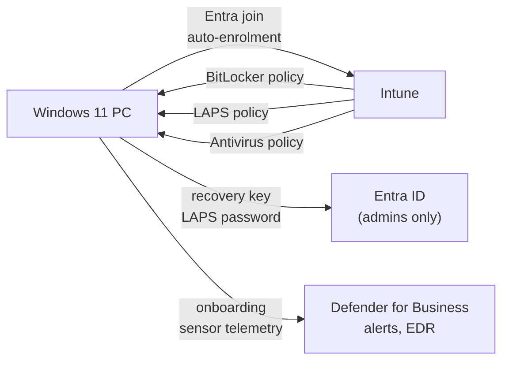

# Endpoint Security with Microsoft Defender and Intune

A pilot that brings company Windows PCs under central management. Each PC is joined to Entra ID and enrolled in Intune automatically. The disk is encrypted with the recovery key stored in Entra ID, and the local admin password rotates on its own. Antivirus runs on a hardened policy that can't be switched off locally, and Defender for Business provides detection and response.

| | |
| --- | --- |
| **Role** | Sole IT administrator: design, configuration, testing, documentation |
| **Platform** | Microsoft 365 Business Premium: Entra ID, Intune, Defender for Business |
| **Scope** | Pilot on the IT admin PC (Windows 11) before wider rollout |
| **Related** | [Microsoft 365 and email security](../07-microsoft-365-email-security/README.md) |
| **Status** | Pilot complete and verified (October 2026) |

## Why

The [Microsoft 365 work](../07-microsoft-365-email-security/README.md) secured the accounts, but the PCs were still managed one at a time. That left three gaps:

- If a laptop was lost, the data on it could be read.
- Local admin passwords were the same on every PC and never changed.
- Antivirus settings depended on whoever last touched each machine.

I tested every control on one PC first, so a bad setting would only break my own machine.

## How it fits together



## What I built

### 1. Entra join and automatic Intune enrolment

- Created a pilot security group and made it the **MDM user scope**, so only its members' devices enrol automatically.
- Joined the PC to Entra ID. It had been registered before the scope was set, so it had to be **disconnected and rejoined** before it would enrol.
- **Snag:** Windows won't let you disconnect a PC unless another local administrator exists, and it refused a personal Microsoft account as that administrator. I created a dedicated local admin account, which later became the account LAPS manages.
- Result: the device shows in Intune as **managed and compliant**.

### 2. Defender for Business

- Onboarded the PC with the local onboarding script and deleted the onboarding package afterwards.
- Ran Microsoft's **detection test**. The alert *Suspicious PowerShell command line* reached the Defender portal, which proved the sensor and the alert pipeline worked from end to end.
- The test alert is resolved with the classification *Security testing* and a comment, so it doesn't sit in the queue looking like a real incident.

### 3. BitLocker disk encryption

| Setting | Value | Why |
| --- | --- | --- |
| Encryption method | XTS-AES 256 | Strongest option available |
| Encryption type | Full disk | Covers previously deleted data as well as used space |
| Startup authentication | TPM only | No PIN for staff to forget, and it still protects a powered-off disk |
| Recovery key | Backed up to Entra ID, **required before encryption starts** | Encryption can never begin without a recovery key IT can reach |

**Verified on the device:** drive C: *Fully Encrypted, Protection On*, with recovery-password and TPM protectors (`manage-bde -status`).

### 4. Windows LAPS

Before this, the local admin password was set by hand and never changed. Now Intune generates and rotates it, and only admins can read it.

| Setting | Value |
| --- | --- |
| Backup directory | Entra ID only |
| Managed account | The dedicated local admin account |
| Password | 20 characters, upper and lower case, numbers and symbols, without look-alike characters |
| Maximum age | 30 days |
| After the password is used | Reset it and sign the account out after an 8-hour grace period |

**Verified:** the password appears in Intune against the device, and signing in to Windows with it works. The password I had set by hand stopped working as soon as LAPS took over the account, which is the intended behaviour.

### 5. Antivirus policy and tamper protection

- **Tamper protection** is on, so neither a user nor malware can switch Defender off locally.
- **EDR in block mode** is on, so Defender can act on detections even if another antivirus product is primary.

| Setting | Value |
| --- | --- |
| Real-time, behaviour and on-access monitoring | On |
| Scanning of downloads, attachments and scripts | On |
| Cloud protection | On, block level **High**, extended timeout 50 seconds |
| Sample submission | Safe samples sent automatically |
| Potentially unwanted apps (PUA) | Blocked |
| Network protection | **Block mode**: stops connections to known malicious sites from any app |
| Signature updates | Every 4 hours |
| Scheduled scan | Daily quick scan |

**Verified on the device**, not just in the portal:

```powershell
Get-MpComputerStatus | Select IsTamperProtected, RealTimeProtectionEnabled, BehaviorMonitorEnabled, AMRunningMode
# True  True  True  Normal

Get-MpPreference | Select PUAProtection, CloudBlockLevel, EnableNetworkProtection
# 1  2  1     (PUA on, cloud block High, network protection in block mode)
```

## Lessons learned

- **Pilot on one machine you can afford to break.** Every surprise here, such as the rejoin and the local admin requirement, would have been a helpdesk call on a staff PC.
- **Check the result on the device, not only in the portal.** "Policy assigned" in Intune only means the policy was sent. `Get-MpComputerStatus`, `manage-bde` and a real LAPS sign-in show what is actually in effect.
- **Escrow the recovery key before encrypting.** Encryption without a key IT can reach turns a forgotten PIN or a motherboard swap into permanent data loss.
- **One control leads to the next.** Rejoining the PC needed a local admin account, and that account is what LAPS now manages.

## Next steps

- Attack surface reduction rules, in **audit mode** first, then block once the logs are clean.
- Windows Update rings, so updates are tested on the pilot before they reach everyone else.
- A compliance policy linked to Conditional Access, so only managed, encrypted devices can open company data.
- Roll the policies out to staff PCs as licences allow.

## Skills demonstrated

`Microsoft Intune` · `Microsoft Defender for Business / Endpoint` · `Entra ID device join` · `BitLocker` · `Windows LAPS` · `Antivirus policy` · `Tamper protection` · `EDR` · `PowerShell` · `Pilot-first rollout`
